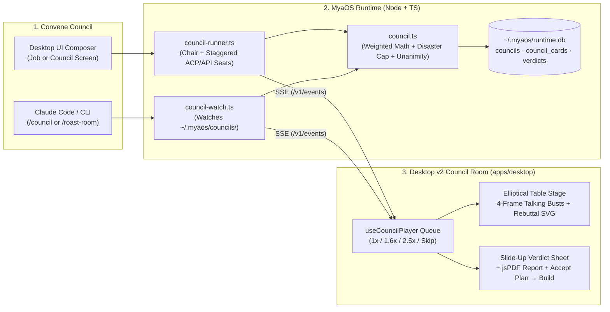

# MyaOS Desktop v2 — Roast-Room Council Adaptation Plan

> **Owner**: Winston  
> **Date**: 2026-11-02  
> **Reference Repo**: [`nateherkai/roast-room`](https://github.com/nateherkai/roast-room.git) (cloned locally at `/Users/winstonzulu/WebstormProjects/roast-room`)  
> **Target Surface**: MyaOS Desktop v2 (`apps/desktop/` + `runtime/` on branch `claude/desktop-app-ai-teams-2fa62f` → `main`)  
> **Status**: Implementation Plan (Phase 1 priority before further Council work)

---

## 1. Outcome & Product Vision

When Winston brings a software architecture decision, product bet, release gate, or business question to a **Planning Council** in MyaOS Desktop v2, the experience must work **almost identically to `roast-room`**, adapted for MyaOS's multi-project, multi-agent control plane:

1. **The Visual Council Room (`#stage`)**: An atmospheric dark round-table stage where 4 to 9 advisors sit along the far arc of an elliptical table, breathing, blinking, tilting their heads while thinking, leaning toward opponents when debating, and moving their mouths (`base`, `mid`, `open`) in sync with each spoken word.
2. **Structured Multi-Round Deliberation**:
   - **Step 1 — Brief (`setup`)**: The Chair frames the decision, defines 2–4 concrete options (`A`, `B`, `C`, `D` — always including a *smaller version* and *don't do it / keep current*), lists explicit assumptions, and assigns relevance weights (`1–3`) to each seated advisor.
   - **Step 2 — Openings (`round1`)**: Each seat delivers its opening card (`STANCE`, `OPTION SCORES`, `PILLAR SCORE`, `CONFIDENCE`, `RUIN RISK`, `DOOR`, `THE CALL`, `WHY`, `THE RISK I SEE`, `WHAT WOULD CHANGE MY MIND`, `WHAT I'D DO THIS WEEK`). Seats speak aloud one at a time via the playback queue while option score bars animate live.
   - **Step 3 — Fault Lines (`cruxes`)**: The Chair identifies the 1–3 core cruxes splitting the room (or triggers the **Unanimity / Too-Fast Agreement Check** if everyone agreed within 1 point) and displays the fault-line cards with overlapping mini portrait faces for each side.
   - **Step 4 — Debate (`round2`)**: Seats directly rebut the colleague they disagree with most (`I DISAGREE MOST WITH`, `I CONCEDE`, `ON THE CRUXES`, `MOVED`, `MY CONDITIONS FOR YES`). Animated SVG dashed rebuttal arcs (`#links`) arc over the table from speaker to target, while the speaker leans toward the target.
   - **Step 5 — Draft Resolution & Ratification Vote (`draft` + `round3`)**: The Chair proposes a draft resolution (`GO`, `GO WITH CONDITIONS`, `RESHAPE`, `WAIT`, `DON'T DO IT`). Each seat votes (`Endorse`, `Endorse with amendment`, `Dissent`), stamping a bold `ENDORSE` / `AMEND` / `DISSENT` badge onto their chest. (Skipped in `--quick` mode when Round 2 spread ≤ 3 and no seat flags `RUIN RISK: likely`.)
   - **Step 6 — The Verdict & One-Click Action (`verdict`)**: A slide-up Verdict Sheet presents the stamped call, option score bars with exact weighted math, top arguments ("Why"), minority report ("Watch out"), cruxes fought, adopted/rejected amendments, cheapest test, kill criteria, **One-Click Branded PDF Download**, and **MyaOS's "Accept Plan & Start Build"** button that turns the verdict into tracked job tasks, criteria, check commands, and stage transition (`plan → build`).

---

## 2. Gap Audit: Current MyaOS v2 vs. `roast-room`

| Capability | `nateherkai/roast-room` | Current MyaOS v2 (`planning.tsx` / `council.ts`) | What Must Be Built / Ported |
|---|---|---|---|
| **Room Stage & Elliptical Table** | Full 16:9.4 stage (`#stage`), elliptical table (`#table`), dynamic seat perspective scaling (`layoutStage`), spotlight (`#spot`), table-edge nameplates (`#plates`). | Static 3-column card grid (`CouncilScreen` in `planning.tsx`), only accessible in `#/preview/council`. | Port `roast-room` stage layout, elliptical geometry (`ResizeObserver`), spotlight, and nameplates into a React component `<CouncilRoomStage />`. |
| **Talking-Head Avatars (4-Frame Busts)** | 4 WebP frames per seat (`-base`, `-open`, `-mid`, `-blink`) + `shapesFor(word)` phoneme lip-sync + `startBlinking()` + `drawnBust()` SVG fallback + `kie.ai`/OpenCV portrait generator. | Static 40px circular `<Avatar />` with 2-letter initials/geometric mark. | Port 4-frame `<TalkingBust />` component, word-by-word lip-sync engine, random blinking, SVG bust fallback, and portrait generator pipeline. |
| **Playback Queue & Speed Controls** | Ordered `player` queue (`1x`, `1.6x`, `2.5x`, `Skip ahead`, `"N lines up next"`) so parallel seat completions play out one speaker at a time with word highlighting. | None. | Port the `CouncilPlayer` state machine hook (`useCouncilPlayer`) with speed controls, word-by-word caption highlighter, and `Skip ahead`. |
| **Rebuttal Arcs & Chest Vote Stamps** | Animated SVG quadratic Bézier arrows (`#links`) between seats in Round 2; spring-animated `.vote` stamps (`ENDORSE`/`AMEND`/`DISSENT`) in Round 3. | Text list of debate items. | Port `<RebuttalLinksSvg />` and `<VoteStamp />` overlays on the stage. |
| **Right-Hand Live Feed & Card Inspector Dialog** | Chronological 1-line feed (`#feed`); clicking any seat/plate/feed item opens `<dialog id="cardDialog">` with Round 1/2/3 tabs and quote verification. | Static card summaries; no modal or round switcher. | Build `<CouncilFeedSidebar />` and `<SeatCardDialog />` with Round 1/2/3 tabs and evidence/quote verification indicators. |
| **Slide-Up Verdict Sheet + PDF Builder** | `#verdictSheet` slide-up modal + 2×2 executive summary + `
` full scorecard + client-side `jsPDF` Montserrat PDF generator (`pdf.js`). | Separate static `#/preview/verdict` route; no PDF generator; "Accept plan" button disabled. | Build `<VerdictSheet />` + port `pdf.ts` (`downloadVerdictPdf`) + wire **"Accept Plan & Start Build"** to `POST /v1/councils/:id/accept`. |
| **Council Runner & Live File Watcher** | `council.mjs` (parallel staggered seat streaming + Chair JSON schemas) AND `watch.mjs` (watches `sessions/<id>/` files written by Claude Code `/roast-room` skill). | `council.ts` only computes math on manually POSTed cards; no seat runner or file watcher. | Add `runtime/src/council-runner.ts` (drives ACP/API seats + Chair across 3 rounds, emits SSE) and `runtime/src/council-watch.ts` (watches CLI council folders). |

---

## 3. Architecture & Adaptation Design

### 3.1 Dual Rosters: MyaOS Engineering/Product Council + Classic Business Board

We adapt `roast-room`'s `roster.json` so Winston can convene **either** (or a hybrid of):

1. **MyaOS Core Council (Default for Software / Product / Ops Jobs)**:
   | Seat Key | Identity | Pillar | The Question They Own | Default Weight Role |
   |---|---|---|---|---|
   | `themis` | **Themis** ⚖️ | Product, UX & User Outcome | Does this create the right user experience without violating product guardrails? | Product / UX |
   | `daedalus` | **Daedalus** ⚙️ | Architecture & Concurrency | What are the systems, state, migration, and concurrency risks? | Architecture |
   | `atlas` | **Atlas** ⏣ | Root-Cause & Feasibility | What does the codebase actually do today, and where will this break in production? | Ground Truth |
   | `kael` | **Kael** 🛡️ | Independent Verification & Downside | How do we prove this works without mocks, and what is the blast radius if it fails? | Downside / Risk Guardian |
   | `astra` | **Astra** ✦ | AI Protocol, SDK & Latency | How does this affect model cost, streaming latency, and client/server contracts? | AI / Protocol |
   | `vela` | **Vela** ✧ | Data Integrity & System of Record | Does this preserve schema contracts, auth boundaries, and substrate truth? | Data / Contracts |
   | `muse` | **Muse** 🎨 | Design Systems & Visual Craft | Is the interface coherent, accessible, and faithful to the brand's design language? | Design / UI |
   | `wren` | **Wren** 🪶 | Growth, Conversion & Distribution | How does this move acquisition, retention, or revenue for the business? | Growth / ROI |
   | `sol` | **Sol** ☀ | Field Operations & Enterprise Workflows | Can real operators run this daily without friction or manual workarounds? | Operations |

2. **Classic Roast-Room Operator Board (Available on Call or for Strategy/Pricing Jobs)**:
   - Ships with all 12 advisor profiles (`bezos`, `graham`, `hormozi`, `garyvee`, `martell`, `wickman`, `buffett`, `naval`, `sanchez`, `leila`, `blakely`, `musk`), their compiled brains, and their 48 existing WebP talking-head frames (`base`, `open`, `mid`, `blink`).
   - Winston can pick **"MyaOS Tech Council"**, **"Business Operator Board"**, **"Chair Recommended Mix"**, or custom `--seats`.

### 3.2 Talking-Head Avatars & Portrait Pipeline

1. **4-Frame Talking Bust Component (`apps/desktop/src/components/council/talking-bust.tsx`)**:
   - Renders `.seat` with `.think` (3 bobbing dots when `seat_start` fires), `.bust[data-shape="base|open|mid|blink"]` containing the 4 preloaded frame images, and `.vote` stamp overlay.
   - **Lip-Sync Word Streamer**: Port `speak()` and `shapesFor(word)` from `roast-room/app/public/app.js`:
     - Splits the spoken headline (`lineFor(round, parsed)`) into `` tokens.
     - Highlights words progressively while mapping vowels/consonants (`aei` → `open`, `ouwy` → `mid`, `mbpf` → `base`) to `.bust[data-shape]`.
   - **Idle Life (`startBlinking` + `breathe` + `ponder`)**:
     - Every seated bust breathes (`5.5s` loop) and blinks randomly (`130ms` every `2.4–6.6s`).
     - When thinking during a round, busts gently tilt (`ponder 6s` with per-seat phase offset).
     - When speaking in Round 2 (`Debate`), the speaker's bust scales (`1.05`) and leans/rotates (`±2.5deg`) toward the seat they are rebutting, while the radial spotlight (`#spot`) tracks their head coordinates.
2. **Immediate Animated SVG Bust Fallback (`drawnBust`) + 3D Cartoon Portrait Generation**:
   - Every MyaOS coworker immediately gets a customized, color-coded SVG talking bust (`drawnBust(key, shape)`) with animated blinking eyes, 3 mouth states (`base`, `mid`, `open`), and their insignia/initials on the chest.
   - Copy the 48 WebP portrait frames from `/Users/winstonzulu/WebstormProjects/roast-room/app/public/portraits/*.webp` into `apps/desktop/public/portraits/`.
   - Port `/newroaster` portrait scripts (`portrait.mjs` + `build_portraits.py`) into `runtime/scripts/portrait/` so we can generate 3D cartoon 4-frame WebP sprites (`<id>-base.webp`, `-open.webp`, `-mid.webp`, `-blink.webp`) for every MyaOS coworker (`themis`, `daedalus`, `atlas`, `kael`, `astra`, `vela`, `muse`, etc.).

### 3.3 The Room UI & Interactive Stage (`apps/desktop/src/screens/planning.tsx`)

Replace the placeholder `PlanningNotYet` and static `CouncilScreen` with the full interactive Roast-Room experience:

1. **Top Bar & 6-Phase Stepper**:
   - Stepper pills: `Brief` → `Openings` → `Fault lines` → `Debate` → `Vote` → `Verdict` with active glow and completion dots.
   - Action buttons: `How it works`, `Past councils` (history modal with 1-click replay & PDF), `New council` / `Back to Job`.
2. **Topic Banner & Live Option Scoreboard (`#topic`)**:
   - Left: `"ON THE TABLE"` kicker + animated type-in decision title.
   - Right: Option rows (`A`, `B`, `C`, `D`) with badge, label, animated score bar (`transition: width .9s cubic-bezier(0.22, 1, 0.36, 1)`), numeric score, leading option highlight, and hover tooltip showing the exact weighted formula.
3. **The Stage (`#stage`)**:
   - `ResizeObserver` computing exact elliptical geometry (`cx`, `cy`, `rx`, `ry`, `edge(x)`) so 1 to 9 seats sit naturally behind the curved table edge at any window size.
   - `<svg class="links">` layer rendering animated dashed quadratic Bézier rebuttal arrows between seats during Round 2.
   - Center-table region (`#center`) hosting:
     - **Convene Composer** (when starting a council from the UI: decision prompt, sample chips, `Full` vs `Quick` mode, board selector, budget/run-count preview).
     - **Live Caption Box** (`#caption`: speaker avatar, name, stance/rebuttal tag, word-by-word highlighted transcript, position-moved subline).
     - **Waitcard** (`#waitcard`: step name, elapsed timer, rotating "what each seat is weighing" muse line, progress bar).
     - **Fault Lines Card** (`#cruxes`: 1–3 cruxes with mini portrait face stacks per side, or Chair unanimity pushback banner).
     - **Verdict Center Plate** (`#plate`: stamped verdict label, call summary, `Read the verdict`, `Accept plan & start build`, `Download PDF`, `Replay`).
   - Floating **Playbar** (`#playbar`): `"N lines up next"`, `1x` / `1.6x` / `2.5x` speed toggle, `Skip ahead`.
4. **Right Sidebar (`#panel`) & Card Dialog (`#cardDialog`)**:
   - Chronological feed of phase dividers, seat 1-liners (with avatar + stance/rebuttal badge), and Chair notes.
   - Clicking any seat bust, nameplate, or feed card opens the **Seat Card Dialog** with Round 1 / Round 2 / Round 3 tabs, full card text, option scores, ruin risk, and quote/evidence verification badges.

### 3.4 Decisions Presentation, Verdict Sheet, PDF & Job Plan Conversion

1. **Slide-Up Verdict Sheet (`<VerdictSheet />`)**:
   - Matches `roast-room`'s `#verdictSheet` (`slideup .55s`, `stampbig .6s` on the `GO` / `GO WITH CONDITIONS` / `RESHAPE` / `WAIT` / `DON'T DO IT` badge).
   - **Top Summary Grid (2×2)**:
     - **Scores**: Option score bars, confidence `/10`, Round 3 vote counts (`endorse`, `amend`, `dissent`).
     - **Why**: Top 3 arguments that carried the room with seat avatars and frameworks.
     - **Watch out**: Minority report card with seat avatar, verbatim quote, and *"For this to be right"*.
     - **Next steps & Kill criteria**: Action items with timeframes (`when` + `action`) and kill condition.
   - **Expandable Full Detail (`
`)**:
     - *Where they fought* (crux resolution stories).
     - *Conditions* (numbered, checkable conditions).
     - *Scorecard Table* (Seat avatar + name, weight, per-option scores, 1-line takeaway, and full weighted math formula).
     - *Cheapest test & Revisit*.
     - *Amendments* (with `Adopted` / `Not adopted` tags and Chair reason).
   - **MyaOS Job Plan Conversion Panel ("Turn Verdict into Job Plan")**:
     - Maps `verdict.next_steps` and `verdict.conditions` into editable MyaOS Job Tasks (each with `title`, `assignee` coworker picker, `checkCommand`, and `gate`) and Job Criteria.
     - Clicking **"Accept Plan & Start Build"** calls `POST /v1/councils/:id/accept`, saves the plan and tasks to the Job, transitions the Job to `plan` (or `build`), and navigates to the Job control plane.
2. **One-Click Branded PDF (`apps/desktop/src/lib/council-pdf.ts`)**:
   - Port `roast-room/app/public/pdf.js` + vendored `jsPDF` and Montserrat fonts into `apps/desktop/`.
   - Generates a crisp, multi-page letter PDF with the MyaOS / Roast Room header, Decision Title, Verdict Call Box, Option Score Bars, Why the Council Landed Here, Advisor Scorecard Table, Watch Out (Minority Report), Next Steps / Cheapest Test / Kill Criteria, and page footers.

---

## 4. Phased Implementation Steps & Acceptance Criteria

### Step 1 — Port Portrait Assets, Brains & Roster into Desktop v2 (`1 day`)
- Copy `roast-room/app/public/portraits/*.webp`, `roast-room/app/public/vendor/jspdf.umd.min.js`, and `roast-room/app/public/brand/fonts/*.ttf` into `apps/desktop/public/`.
- Create `runtime/src/council-roster.ts` combining the **9 MyaOS Core Council seats** (`themis`, `daedalus`, `atlas`, `kael`, `astra`, `vela`, `muse`, `wren`, `sol`) and the **12 Roast-Room Operator seats** (`bezos`, `graham`, `hormozi`, `garyvee`, `martell`, `wickman`, `buffett`, `naval`, `sanchez`, `leila`, `blakely`, `musk`).
- Port `portrait.mjs` and `build_portraits.py` into `runtime/scripts/portrait/` to generate 3D cartoon 4-frame WebP busts for the MyaOS seats (with `drawnBust()` SVG animation active immediately for any seat without WebP frames).

### Step 2 — Upgrade Runtime Council Schema, Runner & File Watcher (`1–2 days`)
- Extend `councils`, `council_cards`, and `verdicts` in `runtime/src/store/migrations.ts` (Migration 3) to store full `roast-room` card fields (`stance`, `call`, `why`, `disagreeWith`, `disagreeLine`, `concede`, `moved`, `vote`, `amendment`, `oneLine`, `quotes`), `cruxes`, `draft`, and rich verdict fields (`why`, `fights`, `minority`, `amendments`, `next_steps`, `cheapest_test`, `kill_criteria`, `revisit`, `votes`).
- Implement `runtime/src/council-runner.ts` (`POST /v1/jobs/:id/councils/:councilId/run` and standalone `POST /v1/councils/run`) to orchestrate Chair + parallel staggered seat runs over ACP (`claude` / `codex` / `gemini`) or API, streaming live SSE events (`phase`, `setup`, `round_start`, `seat_start`, `seat_done`, `round_done`, `cruxes`, `draft`, `verdict`).
- Implement `runtime/src/council-watch.ts` (ported from `roast-room/app/lib/watch.mjs`) to watch `~/.myaos/councils/` and `community/councils/` so councils run from Claude Code CLI (`/roast-room` or `/council`) play live in the Desktop v2 room.
- Ship the 3 example sessions from `roast-room/sessions/` as replayable past councils so Winston can test playback, talking heads, and PDF export immediately.

### Step 3 — Build the Roast-Room Stage, Talking Heads & Player Queue in `apps/desktop` (`2 days`)
- Build `<CouncilRoomScreen />` in `apps/desktop/src/screens/planning.tsx` (and modular subcomponents under `apps/desktop/src/components/council/`):
  - `TalkingBust.tsx` (4-frame WebP + animated SVG fallback + phoneme lip-sync + random blinking + thinking bob + Round 3 vote stamp).
  - `CouncilTableStage.tsx` (elliptical table, `ResizeObserver` perspective layout, radial spotlight, nameplates, SVG rebuttal arcs, center caption/cruxes/waitcard/verdict plate, playbar `1x/1.6x/2.5x/Skip`).
  - `useCouncilPlayer.ts` (ordered playback queue, word-by-word speech timing, replay controller).
  - `CouncilFeedSidebar.tsx` & `SeatCardDialog.tsx` (live 1-line feed + modal card inspector with Round 1/2/3 tabs).

### Step 4 — Build the Slide-Up Verdict Sheet, PDF Export & Job Plan Handoff (`1 day`)
- Build `VerdictSheet.tsx` matching `roast-room`'s slide-up sheet + full detail drawer + MyaOS Task Plan editor.
- Port `council-pdf.ts` (`downloadVerdictPdf`) for 1-click branded PDF download.
- Wire `#/council` and `#/verdict` in `apps/desktop/src/App.tsx` to live runtime endpoints (`GET /v1/jobs/:id/councils`, `POST /v1/councils/:id/accept`, and standalone council history/replay).

---

## 5. Verification & Exit Check

1. **Replay & Talking-Head Check**: Open `#/council` → click **Past sessions** → replay an example council at `1x` and `2.5x` → verify seats sit around the elliptical table, blink idly, move their mouths (`base`/`mid`/`open`) word-by-word as captions highlight, draw SVG rebuttal arcs in Round 2, stamp `ENDORSE`/`AMEND`/`DISSENT` in Round 3, and slide up the Verdict Sheet.
2. **PDF Check**: Click **Download PDF** on the Verdict Sheet → verify a formatted multi-page PDF downloads cleanly with scores, reasons, scorecard table, minority report, and next steps.
3. **Live Council → Job Build Check**: Convene a Quick or Full council on a real MyaOS Job → watch all rounds complete live → click **Accept Plan & Start Build** on the Verdict Sheet → verify `job.plan`, `tasks`, and `criteria` are written to `~/.myaos/runtime.db` and the Job transitions to `build`.
